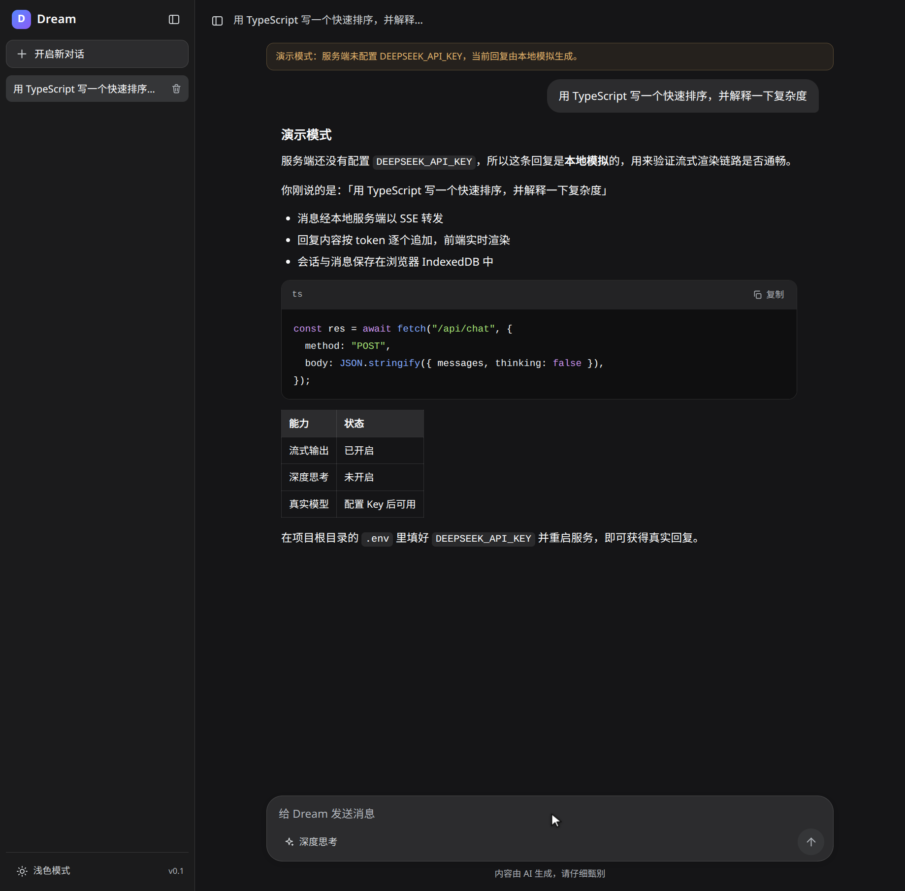
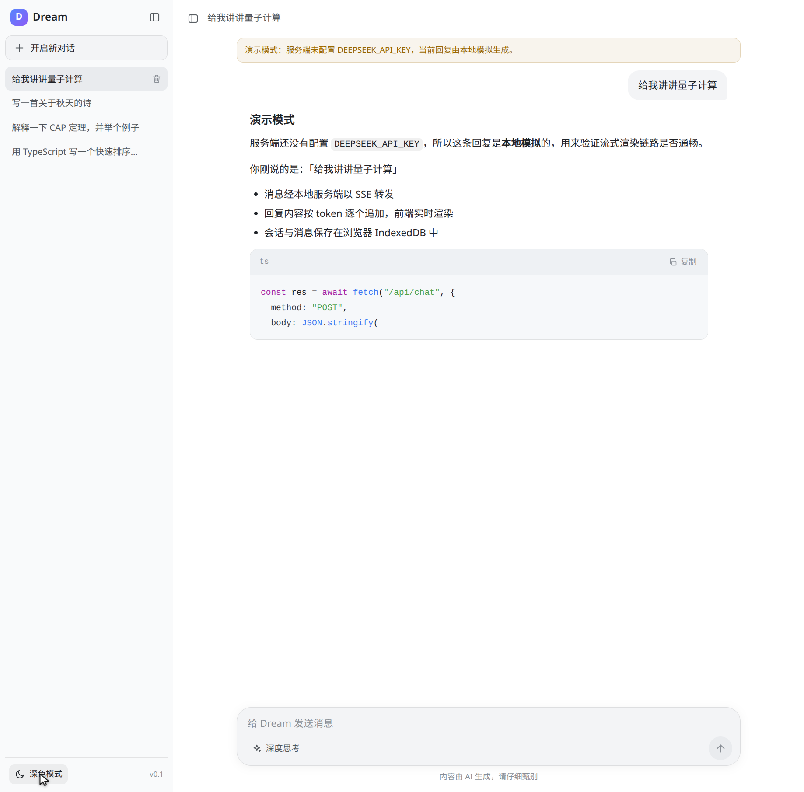
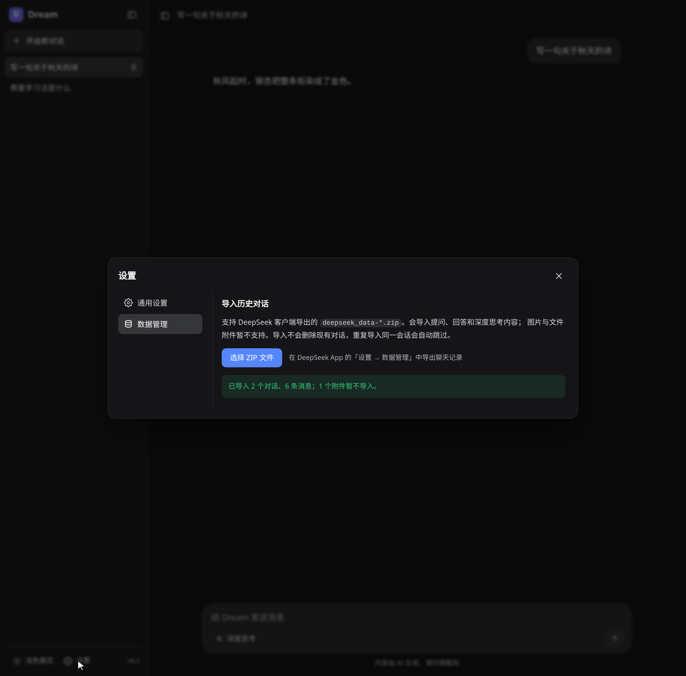
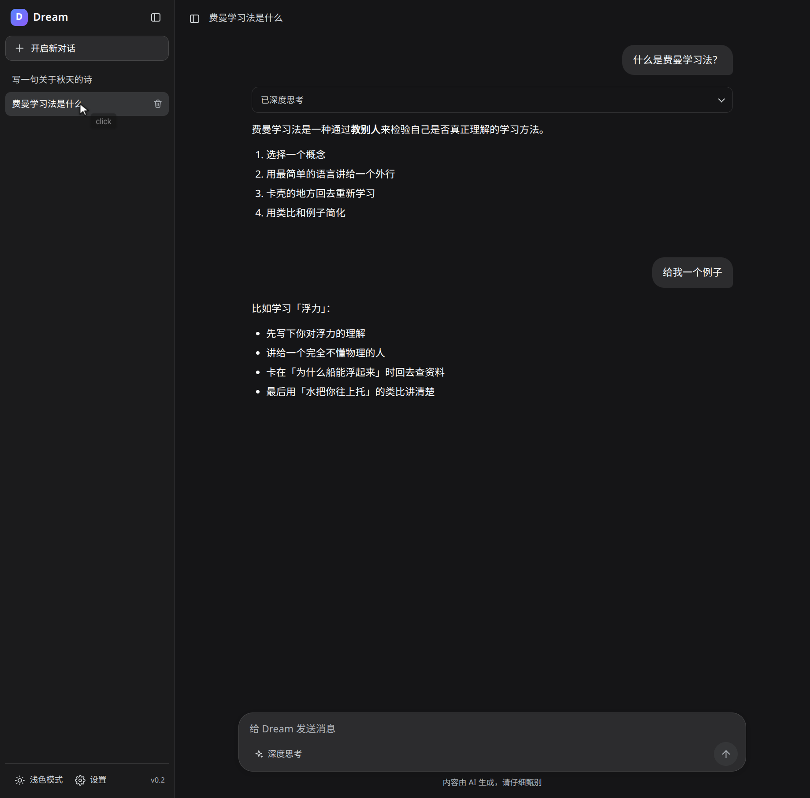
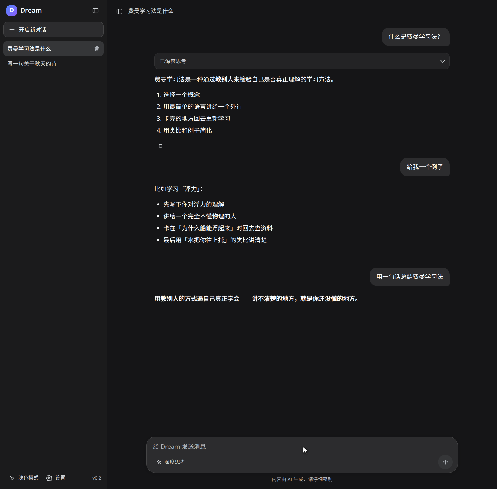

# Dream

一个尽可能贴近 **DeepSeek C 端体验**的聊天客户端：**Web 优先**，服务端负责持有 API Key 并转发流式回复，聊天记录只保存在浏览器本地。

当前版本 **v0.2（M0 + 历史导入）**：可以完成「新建对话 → 输入文本 → 服务端转发 DeepSeek → SSE 流式渲染 → 本地持久化」，并能导入 DeepSeek 客户端导出的聊天记录 ZIP。真实 API 已用 `deepseek-chat` / `deepseek-reasoner` 联调通过。

| 深色 · 空态 | 深色 · 对话 |
| --- | --- |
|  |  |

| 深度思考 | 浅色主题 |
| --- | --- |
|  |  |

| 导入历史对话 | 导入后的会话 |
| --- | --- |
|  |  |

| 真实 DeepSeek API 流式回复 |
| --- |
|  |

## 架构

```text
┌──────────────────────────────┐     POST /api/v1/chat (SSE)        ┌───────────────────────┐
│  Browser / WebView           │ ─────────────────────────────────> │  Dream Server (Hono)  │
│  React 18 + Vite + TS        │ <───────────────────────────────── │  Node + tsx           │
│                              │         streamed SSE chunks        │  :8787                │
│  IndexedDB "dream"           │                                    │  .env API Key         │
│  （会话 / 消息 / 设置）       │                                    └───────────┬───────────┘
└──────────────────────────────┘                                                │ HTTPS
                                                                                v
                                                                     api.deepseek.com
```

- **API Key 只存在于服务端** `.env`，前端代码和浏览器存储里都没有 Key。
- **聊天内容不落服务端**：服务端只做校验、转发和流式透传；会话与消息保存在浏览器 IndexedDB。
- 浏览器 → 服务端 → DeepSeek 的文本请求与 SSE 响应都经过本地服务端，后续可在这一层加登录、单设备校验、限流与配额。

## 技术栈

| 层 | 选型 |
| --- | --- |
| Web | React 18.3、TypeScript 5.9、Vite 7、`idb` 8、`fflate`（ZIP 解压） |
| Markdown | `react-markdown` 10、`remark-gfm` 4、`rehype-highlight` 7 |
| 服务端 | Node 22+（开发用 26）、Hono 4、`@hono/node-server`、tsx |
| 存储 | 浏览器 IndexedDB（库名 `dream`）；服务端暂无数据库 |
| 后续 Android | Capacitor 包同一套 Web 产物（未开始） |

## 快速开始

要求：Node.js ≥ 20，包管理器 pnpm 或 npm。

```bash
cp .env.example .env
# 编辑 .env，填入 DEEPSEEK_API_KEY=sk-...

# 任选其一安装
pnpm install
# 或：npm install

# 一条命令同时起服务端（8787）和 Web（5173）
pnpm dev
# 或：npm run dev
```

打开 <http://localhost:5173>。

没有 API Key 也想先看 UI 和流式链路？用本地模拟模式：

```bash
DREAM_MOCK=1 pnpm dev
```

模拟回复由 `apps/server/src/mock.ts` 生成，不会请求 DeepSeek，也不会消耗 Token。

## 目录结构

```text
apps/
  server/                 # 本地转发服务
    src/index.ts          # Hono 路由：/api/v1/health、/api/v1/models、/api/v1/chat
    src/protocol.ts       # 版本、错误码、统一错误体、SSE 编码
    src/stream.ts         # 把 DeepSeek 上游流归一化为 Dream 事件
    src/deepseek.ts       # 请求校验 + 上游请求
    src/mock.ts           # 无 Key 时的本地模拟流
    src/config.ts         # .env 加载与配置
  web/                    # Web 客户端
    src/App.tsx           # 应用外壳、主题、侧边栏状态
    src/hooks/useChat.ts  # 会话/消息状态机、流式累积、持久化、历史导入
    src/lib/api.ts        # SSE 客户端解析
    src/lib/db.ts         # IndexedDB（idb）
    src/lib/importArchive.ts # DeepSeek 导出 ZIP 解析与格式校验
    src/components/       # Sidebar / ChatView / MessageList / Composer / Markdown / SettingsDialog
    src/styles/           # 设计 token 与布局（对齐实测 DeepSeek 视觉）
docs/
  api.md                  # App ↔ Server 接口契约（v1，权威）
  openapi.yaml            # 机器可读 OpenAPI
  feature-teardown.md     # DeepSeek C 端功能拆解、优先级与实现规格
  screenshots/            # 界面截图
scripts/dev.mjs           # 同时启动 web + server 的开发脚本
```

## 已实现（M0）

- 会话列表：新建、切换、删除，首条用户消息自动生成标题（超长截断）
- 流式对话：SSE 逐块追加渲染；发送中显示「停止生成」，客户端中断会同步中止上游请求
- 多轮上下文：回传历史用户消息与已完成助手消息（错误消息与空回复不进入上下文）
- 深度思考：开关后请求 reasoner 模型，渲染 `reasoning_content` 为默认折叠的思考块
- 消息渲染：Markdown、GFM 表格、代码块高亮、语言标签、一键复制、链接新窗口打开
- 本地持久化：会话/消息存 IndexedDB；刷新后自动恢复上次打开的会话；主题偏好存 localStorage
- 错误处理：未配置 Key、上游鉴权失败、网络失败会在消息内展示可读错误
- 界面：深/浅色主题、桌面/移动端响应式侧边栏、空态、健康状态提示条
- 服务端：请求校验（条数/长度/角色）、SSE 头、AbortSignal 传播、错误信息透出
- 设置弹窗：通用设置（外观、服务状态）与数据管理
- 导入历史对话：解析 DeepSeek 客户端导出的 `deepseek_data-*.zip`（格式版本 3），按 `current_message_id` 还原当前分支，导入提问、回答与深度思考；重复会话自动跳过，图片/文件附件暂不导入

## 服务端接口

完整契约见 [docs/api.md](docs/api.md)（错误码、SSE 事件顺序、版本策略、M1 鉴权预告），机器可读版本见 [docs/openapi.yaml](docs/openapi.yaml)。

| 方法 | 路径 | 说明 |
| --- | --- | --- |
| `GET` | `/api/v1/health` | 存活、模式、是否配置 Key、模型名 |
| `GET` | `/api/v1/models` | 服务端配置的模型 |
| `POST` | `/api/v1/chat` | 流式对话（SSE） |

```bash
curl -N -X POST http://127.0.0.1:8787/api/v1/chat \
  -H 'content-type: application/json' \
  -d '{"messages":[{"role":"user","content":"你好"}],"thinking":false}'
```

```text
event: start
data: {"requestId":"req_...","model":"deepseek-chat","thinking":false,"createdAt":"..."}

event: delta
data: {"delta":"你好"}

event: done
data: {"requestId":"req_...","finishReason":"stop","createdAt":"..."}
```

- 所有响应带 `X-Request-Id`；失败统一返回 `{"error":{"code","message","requestId"}}`。
- 流建立后的错误改用 `event: error`；客户端按事件名分发，未知事件忽略。
- `thinking: true` 使用 `DREAM_REASONER_MODEL`，思考增量在 `event: thinking`。

## 配置项

| 变量 | 默认 | 说明 |
| --- | --- | --- |
| `DEEPSEEK_API_KEY` | 空 | DeepSeek 平台 Key，只在服务端读取 |
| `DEEPSEEK_BASE_URL` | `https://api.deepseek.com` | 上游地址 |
| `DREAM_MODEL` | `deepseek-chat` | 普通对话模型 |
| `DREAM_REASONER_MODEL` | `deepseek-reasoner` | 深度思考模型 |
| `DREAM_MOCK` | `0` | `1` 时启用本地模拟流 |
| `PORT` | `8787` | 服务端端口 |

> 如果账号侧模型名发生变化（例如只提供 `deepseek-flash`），修改 `DREAM_MODEL` / `DREAM_REASONER_MODEL` 即可，无需改代码。

## 导入历史对话

入口：左下角「设置」→「数据管理」→「选择 ZIP 文件」。

支持 DeepSeek 客户端导出的 `deepseek_data-*.zip`（导出格式版本 3）：

- 按每个会话的 `current_message_id` 沿 `parent_id` 还原**当前分支**，不会把已切换走的分支混进来
- 导入提问（`REQUEST`）、回答（`RESPONSE`）、模板回复（`TEMPLATE_RESPONSE`）与思考（`THINK`）
- 原回复状态映射：失败/超时标记为错误；`INCOMPLETE`/`WIP` 视为停止并保留已生成内容
- 会话 id 使用 `ds-<导出会话 id>`；重复导入自动跳过，不会覆盖本地修改
- 图片与文件附件暂不支持，会在结果里提示数量
- 导入在浏览器内完成，ZIP 不会上传到服务端

## 本地数据

- IndexedDB 库名 `dream`，v1：
  - `conversations`：`{ id, title, createdAt, updatedAt }`，索引 `by-updated`
  - `messages`：`{ id, conversationId, role, content, reasoning?, status, error?, createdAt }`，索引 `by-conversation`、`by-created`
- `localStorage`：
  - `dream-theme`：`dark` / `light`
  - `dream-active-id`：上次打开的会话 id

清空数据：浏览器 DevTools → Application → IndexedDB → 删除 `dream`。

## 尚未实现（下一步）

- 登录、单一设备会话、用户管理后台（服务端当前无鉴权，请勿直接暴露公网）
- 智能搜索 / 阅读链接 / 文件上传与解析 / 图片理解（DeepSeek 服务端工具）
- 重新生成、编辑消息、消息分支、继续生成
- 语音输入 / 朗读、KaTeX、Mermaid
- 导出聊天记录、导入图片与附件、更多数据管理操作
- Android（Capacitor）打包、PWA
- 设置页其余项（语言、所在地）

优先级与交互规格见 [docs/feature-teardown.md](docs/feature-teardown.md)。

## Roadmap

| 阶段 | 内容 |
| --- | --- |
| M0 ✅ | Web 骨架、流式聊天、本地持久化、深度思考、主题与响应式 |
| M1 | 服务端登录（JWT）+ `device_id` 单设备会话 + 用户/设备管理 + 限流 |
| M2 | 重新生成 / 编辑 / 分支 / 继续生成、会话搜索、设置页 |
| M3 | 智能搜索、阅读链接、文件上传与解析、引用渲染 |
| M4 | Capacitor Android 壳、录音权限、TTS、返回键与安全区 |
| M5 | 导出、完整数据管理、用量统计、审计 |

> M0.5（已完成）：DeepSeek 导出 ZIP 导入、真实 API 联调、设置弹窗。

## 已知限制

- 真实 API 已联调：`deepseek-chat` 与 `deepseek-reasoner` 当前都会落到账号可用的 `deepseek-flash`（后者自动带思考）。如果账号模型名变化，改 `DREAM_MODEL` / `DREAM_REASONER_MODEL` 即可。
- 只支持纯文本请求；消息里的 Markdown 只做展示，不参与多模态。
- 导入仅支持 DeepSeek 导出格式版本 3 的文本内容；附件、图片、工具调用细节不会保留。
- 停止生成会保留已生成的部分内容，暂不支持「继续生成」。
- 单进程单密钥，无多租户配额；上线前必须补鉴权与限流。
- pnpm 在「home 目录只读」的沙箱里可能因 store 锁失败，此时用 `npm install`（仓库已配置 npm workspaces）即可。

## 开发脚本

| 命令 | 作用 |
| --- | --- |
| `npm run dev` | 同时启动 server + web |
| `npm run dev:server` | 只启动服务端（tsx watch） |
| `npm run dev:web` | 只启动 Web（vite） |
| `npm run build` | 类型检查 + 构建 Web |
| `npm run typecheck` | 两个 workspace 的类型检查 |
| `npm run start` | 以 tsx 启动服务端（无 watch） |

## 安全说明

- `.env` 已在 `.gitignore` 中，不要提交 Key。
- 服务端 CORS 当前对 `/api/*` 全开，仅适合本地开发；部署时收紧到实际域名并加鉴权。
- 聊天内容默认只在用户浏览器本地；服务端日志只记录请求条数与状态，不记录消息正文。

## License 与声明

MIT（见 [LICENSE](LICENSE)）。本项目是非官方实现，仅用于学习与技术验证；DeepSeek 名称与商标归其所有者。界面尺寸、配色与文案参考 DeepSeek 官方 Web 端与 MIT 开源的 `chat-demo` 实测，以便保持体验一致。
